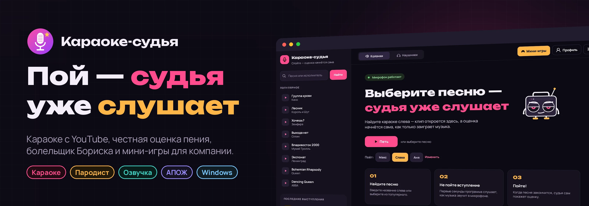
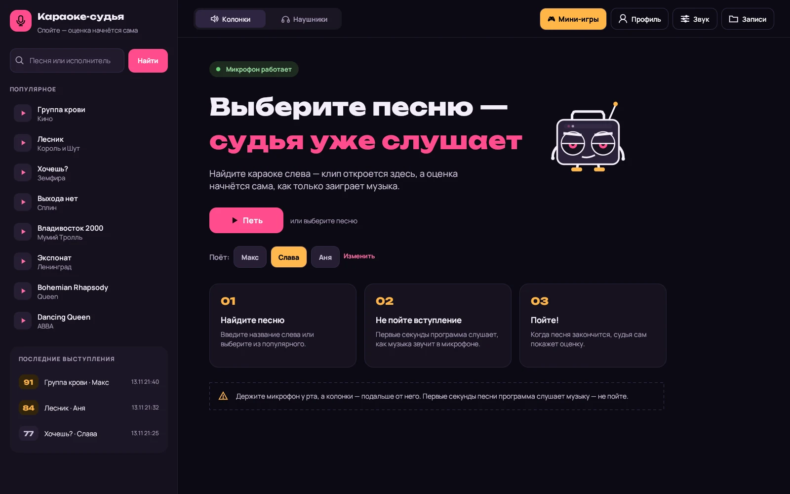
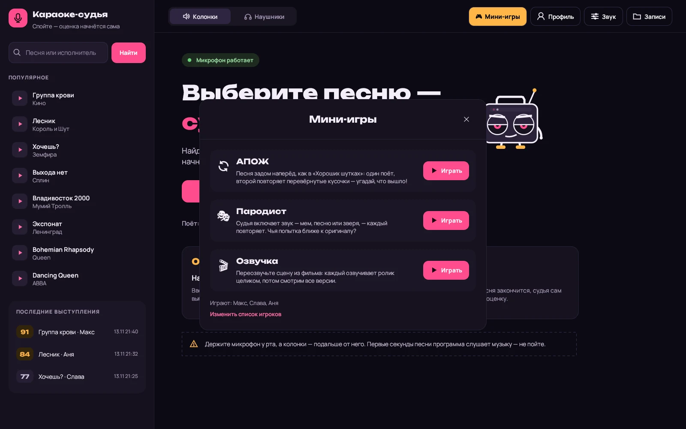
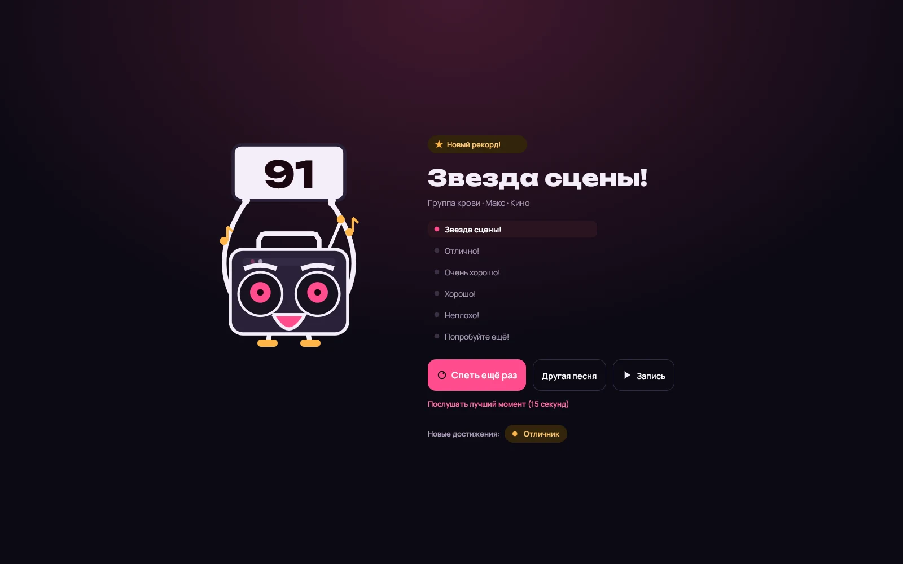
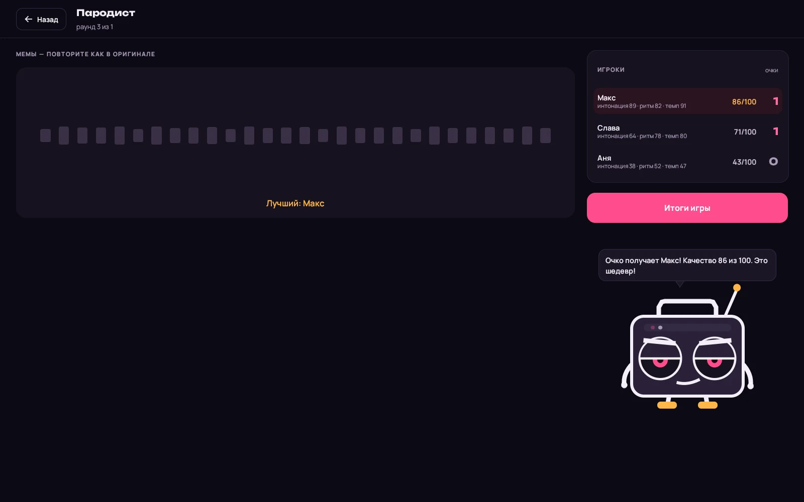
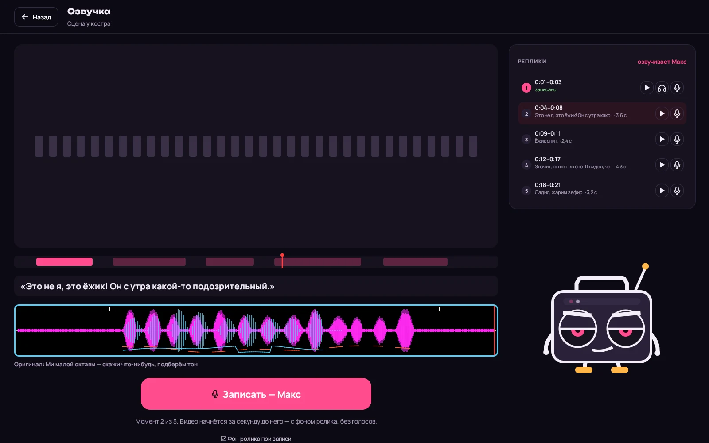
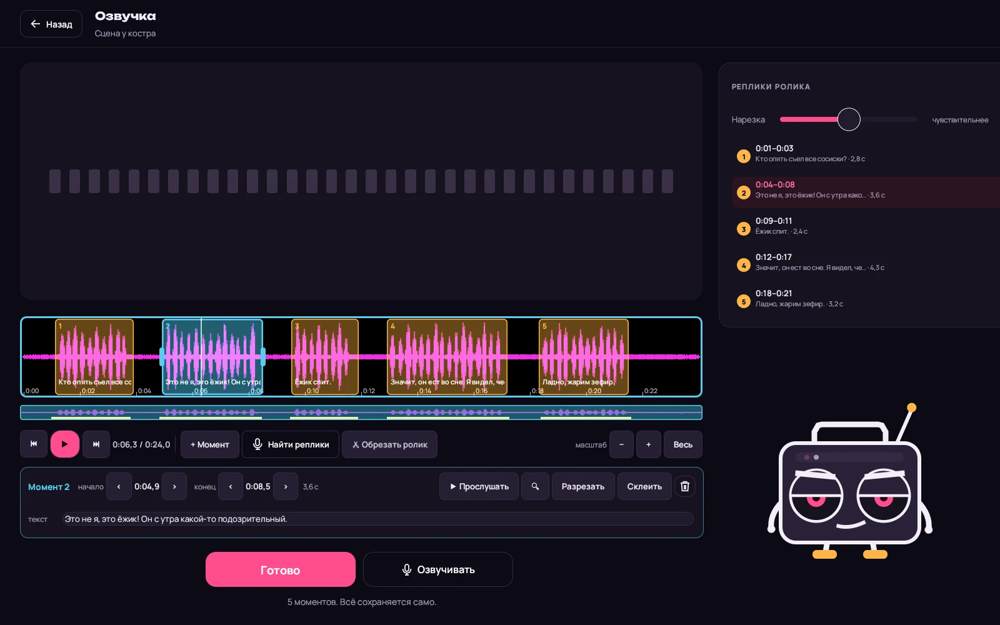
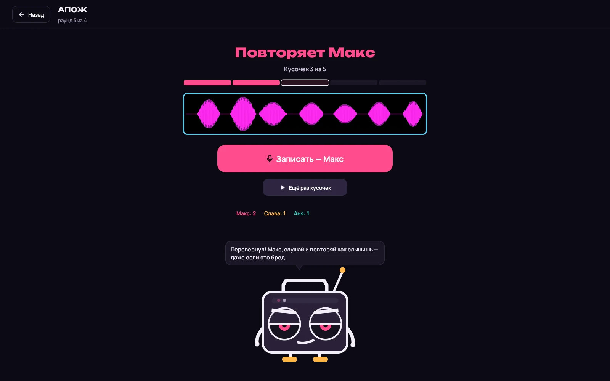

<p align="center">
  
</p>

<p align="center">
  <a href="../../releases/latest"></a>
  
  
  
  
</p>

<p align="center">
  <b>Домашнее караоке, которое честно оценивает пение: включаете любой караоке-клип с YouTube прямо в программе, поёте в микрофон — и получаете балл.</b><br>
  Плюс болельщик Бориска, записи выступлений и три мини-игры для компании: «Пародист», «Озвучка» и «АПОЖ» — песня задом наперёд.
</p>

<p align="center">
  <a href="../../releases/latest"></a>
</p>

<p align="center">
  
</p>

---

## ✨ Что умеет

<table>
<tr>
<td width="50%" valign="top">

### 🎤 Караоке с оценкой
- Поиск караоке-клипов YouTube **прямо в программе**, клип играет во встроенном окне
- Слушает микрофон и ставит балл: попадание в ноты, стабильность, сколько вы действительно пели
- Не засчитывает молчание и музыку из колонок, не путает высокие ноты на октаву
- Каждое выступление записывается — с названием песни, именем певца и датой
- **Лучший момент** записи: программа сама находит самый удачный кусок

</td>
<td width="50%" valign="top">

### 🤖 Бориска — болельщик
- Оригинальный персонаж-бумбокс: подпевает, а лицо меняется от высоты ноты
- После песни показывает табличку с баллом и комментирует результат, в мини-играх — фразами из мемов
- Помнит прошлые выступления и делает прогноз перед песней
- Звуки зала: аплодисменты, «у-у-у», свист — синтезированы, без чужих записей

</td>
</tr>
<tr>
<td valign="top">

### 🎧 Звук как на сцене
- Голос в колонки или наушники с реверберацией и эхом
- **Эхоподавление**: программа вычитает из микрофона то, что играют колонки
- Шумоподавление (RNNoise) и регулировка громкости микрофона
- **Автотюн**: голос в колонках подтягивается к ближайшей ноте — мягко или «как робот»
- Тест голоса: ваш диапазон, тип голоса и подходящие песни

</td>
<td valign="top">

### 👥 Для компании
- **«Играют сегодня»** — один список игроков для караоке и всех игр, очередь певцов
- Профиль с достижениями, история выступлений
- 4 цветовые схемы: «Сцена», «Неон», «Закат», «Лес»
- **Portable**: всё хранится рядом с программой — можно носить на флешке

</td>
</tr>
</table>

## 🎮 Мини-игры

<p align="center">
  
</p>

<table>
<tr>
<td width="33%" valign="top">

### 🎭 Пародист
Судья включает звук — отрывок песни, фразу из мема или голос животного, — и все по очереди его повторяют. Сравниваются интонация, ритм и темп, лучший в раунде получает очко.

Звуки — ваши: наборы в трёх категориях **Музыка, Мемы, Животные**, добавляются перетаскиванием файлов, с обрезкой прямо в программе.

</td>
<td width="33%" valign="top">

### 🎬 Озвучка
Переозвучьте сцену из фильма. Программа режет ролик на реплики (с дополнением «Нейросети» голоса из фона убираются начисто, а реплики находятся точнее; текст для суфлёра берётся из субтитров .srt или вписывается вручную), игрок озвучивает его целиком: оригинал → запись → следующий момент, под фон ролика без голосов. Потом следующий игрок берёт тот же ролик — и версии сравниваются.

Ролики разложены по категориям, а кнопка «Случайный ролик» выберет сцену сама. В конце — **готовое видео с вашими голосами** в mp4. Ролики можно обрезать кусками прямо в программе — точно до кадра, разметка моментов при этом сохраняется.

</td>
<td width="33%" valign="top">

### 🔄 АПОЖ
Песня задом наперёд, как в «Хороших шутках». Один поёт кусочек песни, запись переворачивается и режется на кусочки, второй повторяет каждый перевёрнутый кусочек.

Повторы склеиваются и переворачиваются обратно — что это была за песня?

</td>
</tr>
</table>

## 📸 Скриншоты

<table>
<tr>
<td width="50%"><p align="center"><sub><b>Результат</b> — балл, Бориска с табличкой, лучший момент и достижения</sub></p></td>
<td width="50%"><p align="center"><sub><b>Пародист</b> — интонация, ритм и темп каждой попытки</sub></p></td>
</tr>
<tr>
<td><p align="center"><sub><b>Озвучка</b> — окно голоса: волна оригинала, ваша запись и подсказка по тону</sub></p></td>
<td><p align="center"><sub><b>Редактор ролика</b> — моменты с текстом реплик, масштаб, обрезка</sub></p></td>
</tr>
<tr>
<td><p align="center"><sub><b>АПОЖ</b> — перевёрнутые кусочки песни по очереди</sub></p></td>
<td valign="middle"><p align="center"><sub>На скриншотах — демо-стенд: игроки, звуки и баллы выдуманы специально для этой страницы.</sub></p></td>
</tr>
</table>

## 🚀 Установка

1. Скачайте архив из [последнего релиза](../../releases/latest):
   - **`Karaoke-sudya-vX.Y.Z.zip`** — программа, ~9 МБ;
   - **`Karaoke-sudya-AI-addon-vX.Y.Z.zip`** — дополнение «Нейросети», ~80 МБ, по желанию. Распакуйте его в ту же папку, что и программу: в «Озвучке» голоса из ролика будут убираться начисто, без интернета. Ролик обрабатывается один раз при добавлении — от полуминуты до пары минут, смотря по процессору. Нужен процессор с AVX2 (почти любой после 2013 года). Дополнение не нужно обновлять с каждой версией программы.
2. Распакуйте в любую папку — например, на рабочий стол или флешку.
3. Запустите **`Karaoke-sudya.exe`**.

Нужны Windows 10 или 11 и **WebView2** — в Windows 11 он уже есть, в Windows 10 обычно ставится вместе с Edge (если клипы не открываются — [скачайте у Microsoft](https://developer.microsoft.com/microsoft-edge/webview2/)).

Всё, что создаёт программа, лежит рядом с ней:
```
Karaoke\
  Karaoke-sudya.exe   ffmpeg.exe   WebView2Loader.dll   …
  kj-demucs.exe   models\   — дополнение «Нейросети» (если поставили)
  Записи\      — записи выступлений
  Озвучка\     — ролики, разметка моментов, звук без голосов (*.bg); Готовые\ — видео с озвучкой
  Пародист\    — Музыка, Мемы, Животные и ваши наборы звуков
  Данные\      — настройки, история, достижения
```
**Обновление:** распакуйте новый архив поверх старого — записи и настройки останутся.

> 💡 **Колонки или наушники?** В наушниках оценка точнее всего. С колонками держите микрофон у рта, а колонки подальше — эхоподавление уберёт музыку, но первые секунды песни программа «слушает» зал.

<details>
<summary><b>Свои звуки для «Пародиста» и ролики для «Озвучки»</b></summary>

- **Пародист:** перетащите mp3, wav, ogg, flac или m4a в окно игры — файлы попадут в выбранный набор, а целая папка станет новым набором. Название звука — это имя файла. Можно и просто класть файлы в папки `Пародист\Музыка`, `Пародист\Мемы`, `Пародист\Животные`.
- **Озвучка:** лучше всего — сцена с диалогом на 20–90 секунд в mp4. После добавления откроется редактор (потом — кнопка ✂ у ролика): проверьте моменты, подвиньте края, а в «✂ Обрезать ролик» вырежьте лишние куски и посмотрите предпросмотр. Сохраняется насовсем или копией; видео режется без перекодирования, поэтому каждый кусок начинается с ближайшего ключевого кадра.
- **Субтитры:** файл `.srt` или `.vtt` с тем же именем, что у ролика (или перетащенный в окно), станет моментами с текстом — в любой версии.
</details>

## 🛠 Для разработчиков

<details>
<summary><b>Как устроен проект</b></summary>

```
src/main.rs      — окно, экраны караоке, записи, профиль, настройки, «Играют сегодня»
src/audio.rs     — микрофон, колонки и захват их звука (WASAPI), анализ, запись, плеер
src/dsp.rs       — эффекты, высота голоса (McLeod), оценка пения
src/cleanup.rs   — эхоподавление (SpeexDSP) и шумоподавление (RNNoise)
src/search.rs    — поиск на YouTube
src/avatar.rs    — Бориска; src/sfx.rs — синтезированные звуки зала
src/mimic.rs     — сравнение пародий: интонация, ритм, темп (DTW)
src/game.rs, sounds.rs   — «Пародист» и его наборы звуков
src/dub.rs, wave.rs, ff.rs — «Озвучка», волны и редакторы, вызов ffmpeg
src/subtitles.rs — субтитры .srt / .vtt
src/separate.rs  — отделение голосов от фона (kj-demucs, tools/demucs)
src/apozh.rs     — «АПОЖ»
src/theme.rs, ui_kit.rs  — цветовые схемы, шрифты, кнопки и иконки
third_party/speexdsp     — исходники SpeexDSP (BSD)
tools/           — сборка ffmpeg и kj-demucs, скриншоты и баннер для этой страницы
```
</details>

<details>
<summary><b>Сборка</b></summary>

Программа собирается под Windows из Linux (MinGW):
```bash
sudo apt install mingw-w64
rustup target add x86_64-pc-windows-gnu
cargo build --release --target x86_64-pc-windows-gnu
```
Рядом с exe нужны `WebView2Loader.dll` (лежит в `target/.../build/webview2-com-sys-*/out/x64/`) и `ffmpeg.exe`:
```bash
git clone --depth 1 -b n7.1 https://github.com/FFmpeg/FFmpeg.git ffsrc
tools/ffmpeg-build.sh ffsrc win ffbuild      # ffbuild/ffmpeg.exe, ~3 МБ
```
**Тесты** (анализ звука, нарезка, эхоподавление, резка видео):
```bash
tools/ffmpeg-build.sh ffsrc linux ffbuild-linux
KJ_FFMPEG=ffbuild-linux/ffmpeg cargo test --release --target x86_64-unknown-linux-gnu
```
**Картинки для README** — демо-стенд с выдуманными данными (только в Linux-сборке):
```bash
cargo build --release --target x86_64-unknown-linux-gnu
tools/screens.sh && python3 tools/banner.py
```
**Новая версия.** Поменяйте `version` в `Cargo.toml`, добавьте раздел в `CHANGELOG.md` и отправьте в `main` — GitHub Actions соберёт программу, ffmpeg и kj-demucs, упакует оба архива (модель берётся из релиза [models](../../releases/tag/models) с проверкой SHA-1) и опубликует релиз с описанием из `CHANGELOG.md` (см. `.github/workflows/release.yml`).
</details>

<details>
<summary><b>Сторонние компоненты и лицензии</b></summary>

| Компонент | Для чего | Лицензия |
|---|---|---|
| [SpeexDSP](https://github.com/xiph/speexdsp) | эхоподавление | BSD |
| [nnnoiseless](https://github.com/jneem/nnnoiseless) (RNNoise) | шумоподавление | BSD |
| [FFmpeg](https://ffmpeg.org) 7.1, минимальная сборка | резка роликов и сборка видео | LGPL 2.1+ — параметры сборки в `tools/ffmpeg-build.sh` |
| [egui / eframe](https://github.com/emilk/egui), [wry](https://github.com/tauri-apps/wry), [cpal](https://github.com/RustAudio/cpal), [symphonia](https://github.com/pdeljanov/Symphonia) | окно, встроенный браузер, звук, декодеры | MIT / Apache 2.0 |
| [Demucs](https://github.com/facebookresearch/demucs) (htdemucs) через [demucs.cpp](https://github.com/sevagh/demucs.cpp) | отделение голосов от фона (дополнение «Нейросети») | MIT |
| Шрифты [Unbounded](https://github.com/googlefonts/unbounded) и [Manrope](https://github.com/sharanda/manrope) | интерфейс | SIL OFL 1.1 |

Тексты лицензий лежат рядом с компонентами: `third_party/speexdsp/COPYING`, `assets/fonts/OFL-*.txt`, `LICENSE-ffmpeg.txt` и `LICENSE-demucs.txt` в архиве с программой.
</details>

## ℹ️ О проекте

Программа **не скачивает видео с YouTube**: клипы открываются в обычном встроенном браузере, как на сайте. Проект не связан с YouTube и Google. Записи мемов, фильмов и песен в программу не входят — звуки для игр добавляете вы сами. Персонаж Бориска нарисован специально для проекта.

Игра «АПОЖ» придумана по мотивам конкурса из передачи «Хорошие шутки». Код распространяется по лицензии [MIT](LICENSE).

<p align="center"><sub>Сделано для вечеров, когда «ну ещё одну песню» звучит в пятый раз</sub></p>
